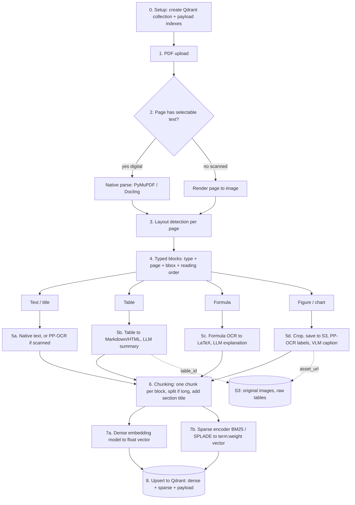
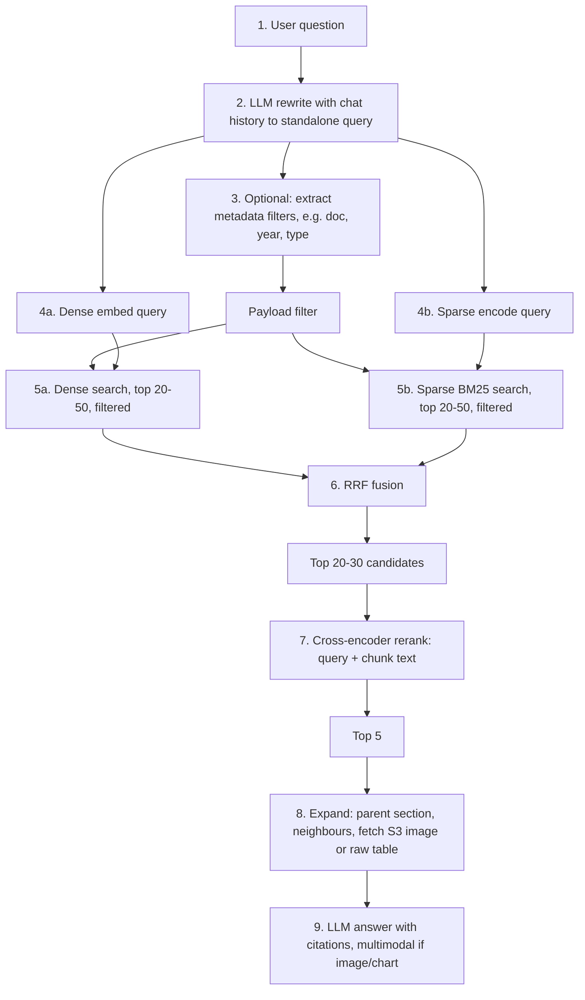

# Advanced RAG Guide (PDF with text, tables, images, charts, formulas)

## 0. Naive vs Advanced RAG

| Stage | Naive RAG | Advanced RAG |
| --- | --- | --- |
| Ingestion | Plain text extraction, fixed-size chunks | Layout-aware parsing, OCR, per-type enrichment (VLM/LLM), section-based chunking, metadata |
| Query | Raw query embedded | Rewrite with chat history, filter extraction |
| Retrieval | Dense vector top-k | Hybrid (dense + BM25 sparse) with metadata filters, RRF fusion |
| Post-retrieval | Chunks go straight into the prompt | Cross-encoder rerank, parent/neighbour expansion, fetch original image/table |
| Generation | Text LLM | Multimodal LLM when needed, citations |

## 1. Core concepts

### OCR vs VLM

| Tool | Answers | Good for | Not good for |
| --- | --- | --- | --- |
| **OCR** (PP-OCR) | "What text is written in this image?" | Scanned pages, screenshots, labels and numbers on charts | Describing meaning (trends, diagrams, photos) |
| **VLM** (GPT-4o, Claude, Qwen-VL) | "What does this image show or mean?" | Chart/diagram/photo summaries | Exact character-level text |

Plain PP-OCR returns only text boxes. **PP-StructureV3** (PaddleOCR layout pipeline) adds layout detection, table structure and formula recognition. Charts and diagrams still need a VLM.

### How to know a block is an image, table or formula

There is no stream that announces "an image starts here". Detection happens per page, before chunking:

1. **Native PDF objects (digital PDFs):** PyMuPDF `page.get_images()`, `page.get_image_bbox()`, `page.find_tables()` return embedded images and tables with positions.
2. **Layout detection (scanned PDFs, vector charts):** render the page to an image, then a layout model (PP-StructureV3, Docling, MinerU) returns labeled boxes (`text`, `title`, `table`, `figure`, `formula`) with coordinates. Vector charts are drawn with path commands, not embedded images, so only this method finds them.

### Dense vs sparse vs cross-encoder

| | Dense (bi-encoder) | Sparse (BM25) | Cross-encoder |
| --- | --- | --- | --- |
| Input | Query and chunk encoded separately | Query terms vs chunk terms | Query and chunk together |
| Strength | Meaning, paraphrases | Exact words, IDs, numbers, codes | Best relevance judgement |
| Speed | Fast (ANN/HNSW index) | Fast (inverted index) | Slow, so only top 20-50 |
| Role | Recall | Recall | Precision |

## 2. Ingestion pipeline (offline, runs once per PDF)

Order matters: parse the whole page into typed blocks first, enrich each block, then chunk, then embed. Chunking never pauses mid-way to call a VLM.



#### Parser stage detail (Docling)

The parser's job is to split the PDF into typed blocks and to know which section each block belongs to. Docling does this in one pass and returns a `DoclingDocument`.

```text
[ Input PDF ]  (digital text, scanned pages, handwriting, tables, formulas, charts, flowcharts)
      │
      ▼
[ Docling Parser ]
  - layout model: labels every region (section_header, text, list_item, table,
    picture, formula, code, caption, page_header/footer)
  - reading order + section hierarchy (which heading owns which block)
  - TableFormer: table cells to rows/columns
  - OCR: only for scanned pages and image regions (EasyOCR / Tesseract / RapidOCR)
      │
      ▼
[ DoclingDocument ]  typed items, each with: type, page, bbox, reading order, parent section
      │
      ├── section_header / text / list_item ─> Markdown text (OCR text if scanned)
      ├── table ─────────────────────────────> Markdown/HTML + raw JSON (S3) + LLM summary
      ├── formula ───────────────────────────> LaTeX + LLM explanation
      ├── picture (chart, flowchart) ────────> crop -> S3 -> VLM caption + OCR labels
      └── handwriting / low-confidence OCR ──> crop -> multimodal VLM transcription
      │
      ▼
[ Chunking ]  one chunk per item, section title + parent ids attached (Docling HybridChunker)
      │
      ▼
[ Embedding: dense + sparse ] ─> [ Qdrant ]  (+ S3 for crops and raw tables)

Query time is a separate flow (section 4):
Qdrant retrieval -> rerank -> multimodal LLM gets text + the original image clips
```

Notes on this stage:

- **Section knowledge comes from the parser.** `section_header` items and the hierarchy tell you which heading each block sits under. Store it as the `section` payload field and prepend it to chunk text.
- **Handwriting is not a block type.** The layout model only labels regions as text or picture. Standard OCR is weak on handwriting, so route by policy: low OCR confidence, or a region flagged as handwritten, goes to the VLM.
- **Tables and formulas are separate branches.** They need their own handling (structure, LaTeX), not the text path.
- **The final multimodal VLM runs at query time**, not during ingestion. Ingestion VLM calls only produce captions and transcripts.

### Step by step

| # | Step | What happens |
| --- | --- | --- |
| 0 | Setup | Create the collection with named vectors (`dense`, `sparse` with `modifier: idf`). Create payload indexes on filter fields (`doc_id`, `type`, `page`, `year`, ...) before loading data. |
| 1 | Upload | Receive the PDF. Small: process synchronously. Large: queue (SQS/Celery), process page by page with parallel workers. |
| 2 | Classify page | Selectable text means native parse. No text layer means render to image and use OCR. |
| 3 | Layout detection | Label regions on each page: text, title, table, figure, formula, header/footer. |
| 4 | Typed blocks | Each block has `type`, `page`, `bbox`, `reading_order`, `section`. |
| 5 | Per-type extraction/enrichment | See table below. VLM and LLM calls run as parallel or queued jobs, cached by image hash. |
| 6 | Chunking | One chunk per block. Long text is split by section/paragraph. Attach section heading and neighbour ids (parent-child). Do not merge a table or figure into surrounding text. |
| 7 | Embedding | Dense vector from the embedding model, sparse vector from BM25 (or SPLADE) over the same chunk text. |
| 8 | Store | Upsert one Qdrant point per chunk. Upload assets to S3 and link them in the payload. |

### Per-type handling

| Block type | Extraction | Enrichment | Text that gets embedded | Stored outside the vector DB |
| --- | --- | --- | --- | --- |
| Text | Native text, or PP-OCR | None | The chunk itself | Nothing |
| Table | Table structure to Markdown/HTML | LLM summary for large tables | Markdown plus summary | Raw table JSON/HTML |
| Image/chart | Crop, PP-OCR for labels | VLM caption plus data summary, given nearby caption and section title as context | Caption plus OCR labels | Cropped PNG in S3 |
| Formula | Formula OCR to LaTeX | LLM plain-language explanation | LaTeX plus explanation | None |

Images are never embedded as pixels in this approach. Their VLM summary is.

## 3. What is stored in Qdrant

Both vectors live on the same point as named vectors. Sparse is computed at index time, not only at search time.

```json
{
  "id": "doc12_p7_fig2",
  "vectors": {
    "dense":  [0.012, -0.44],
    "sparse": { "indices": [1021, 5530, 90412], "values": [1.8, 0.9, 2.4] }
  },
  "payload": {
    "doc_id": "doc12",
    "page": 7,
    "type": "image",
    "bbox": [72, 300, 520, 640],
    "section": "3.2 Financial Results",
    "text": "Bar chart: quarterly revenue Q1-Q4 2024, 2.1M to 3.4M",
    "asset_url": "s3://bucket/doc12/p7_fig2.png",
    "raw_table": null
  }
}
```

Embed the searchable text. Keep the raw table or image in the payload or S3.

### How sparse (BM25) works

Dense vectors capture meaning ("car" is near "automobile"). Sparse vectors capture exact terms: names, IDs, numbers, error codes.

At index time:

1. Tokenize the chunk text (lowercase, optional stemming and stop-word removal).
2. Map each unique word to an integer id. The vector has one dimension per vocabulary word and is mostly zeros, hence "sparse".
3. Compute a weight per word with BM25:

$$
\text{score}(q,d)=\sum_{t\in q}\text{IDF}(t)\cdot\frac{tf(t,d)\,(k_1+1)}{tf(t,d)+k_1\left(1-b+b\frac{|d|}{\text{avgdl}}\right)}
$$

- $tf$: how often the term appears in the chunk.
- $\text{IDF}$: rarity of the term across all chunks. Rare terms weigh more.
- $|d|/\text{avgdl}$: length normalization, so long chunks are not favoured.
- Typical constants: $k_1\approx1.2$, $b\approx0.75$.

4. Store only the non-zero entries as `{indices, values}`.

At query time:

- The query is tokenized the same way. Only which terms are present matters.
- Qdrant takes the dot product between the query's sparse vector and the stored ones. With `modifier: idf` on the sparse vector, Qdrant maintains IDF on the server as data changes. FastEmbed's `Qdrant/bm25` model produces the vectors.
- Alternative: learned sparse (SPLADE, BGE-M3 sparse). A neural model produces the weights and expands terms ("car" also activates "vehicle"). More accurate, but heavier.

## 4. Query pipeline (online, per user question)



| # | Step | What happens |
| --- | --- | --- |
| 1-2 | Rewrite | The LLM uses previous questions and answers to turn a follow-up ("what about Q4?") into a standalone query. |
| 3 | Filters (optional) | The LLM extracts metadata filters from the question ("in the 2024 report" becomes `year = 2024`). |
| 4 | Encode | Dense embedding and sparse encoding of the rewritten query. |
| 5 | Search | Dense and sparse searches run in parallel, each with the same filter, each returning its own top N. |
| 6 | Fusion | RRF merges the two ranked lists. |
| 7 | Rerank | A cross-encoder scores each (query, chunk) pair and keeps the top 5. It reads text only, so images are ranked by caption and OCR text. |
| 8 | Expand | Fetch parent section and neighbouring chunks. For `type=table` fetch the raw table. For `type=image` fetch the S3 image. |
| 9 | Generate | LLM answers from the context and cites doc and page. A multimodal LLM receives the actual image for chart questions. |

### Hybrid query in Qdrant

Put the filter on each prefetch. A filter only on the outer query does not constrain the prefetch candidates.

```python
client.query_points(
    collection_name="docs",
    prefetch=[
        Prefetch(query=dense_vec, using="dense", limit=30, filter=flt),
        Prefetch(query=sparse_vec, using="sparse", limit=30, filter=flt),
    ],
    query=FusionQuery(fusion=Fusion.RRF),
    limit=20,
)
```

### How filtering works inside the search

The filter is not applied after the search. It is applied during the search, so the top N is taken from points that already match.

| Filter selectivity | What Qdrant does |
| --- | --- |
| Very selective (few matches) | The payload index gives the matching point IDs, then only those points are scored (exact). |
| Broad (many matches) | HNSW graph traversal checks the filter on each visited point and skips non-matching ones until N valid results are found (filterable HNSW). |

Qdrant picks the strategy per query using a cardinality estimate from the payload index. For sparse search, the inverted index finds candidates and each one is checked against the filter before it counts.

Post-filtering is avoided because it can leave fewer than N results, or none. The payload index does not rank anything. It only makes filtering fast and feeds the planner. Create payload indexes on filter fields before inserting data.

### RRF (Reciprocal Rank Fusion)

Dense scores (cosine, e.g. 0.83) and BM25 scores (e.g. 14.2) are on different scales, so they cannot be added. RRF uses ranks only:

$$
\text{RRF}(d)=\sum_{r\in\{\text{dense},\text{sparse}\}}\frac{1}{k+\text{rank}_r(d)},\quad k=60
$$

| Chunk | Dense rank | Sparse rank | RRF score |
| --- | --- | --- | --- |
| A | 1 | 5 | 1/61 + 1/65 = 0.0318 |
| B | 3 | 1 | 1/63 + 1/61 = 0.0323 |
| C | 2 | not found | 1/62 = 0.0161 |

B wins because both retrievers rank it well.

## 5. End-to-end summary

```text
INDEX: PDF -> page classify -> layout blocks -> per-type extraction + VLM/LLM enrichment
       -> chunks (one per block + section + parent ids)
       -> dense vector + sparse vector + payload -> Qdrant (+ S3 for assets)

QUERY: question + history -> rewrite -> (filters)
       -> dense top-N || sparse top-N (same filter) -> RRF -> cross-encoder top 5
       -> expand (parents, image, raw table) -> LLM -> answer + citations
```

## 6. Large PDFs and cost

- Process page by page in a queue with parallel workers.
- Use OCR only on pages with no text layer.
- Batch VLM calls and cache by image hash.
- Re-ingest only changed pages (hash per page).

## 7. Alternative: skip OCR with ColPali / ColQwen

These models embed whole page images, so layout, charts and tables are handled in one step. Retrieval is strong for visually complex documents, but storage is heavier and a multi-vector store is needed (Qdrant and Vespa support this). Many teams combine both: parsed text for the main path, ColPali for visually heavy pages.

## 8. Tool choices

- Simplest: Docling or Unstructured, plus a VLM for figures.
- Open-source OCR/layout: PP-StructureV3 or MinerU.
- Managed: LlamaParse or Azure Document Intelligence.
